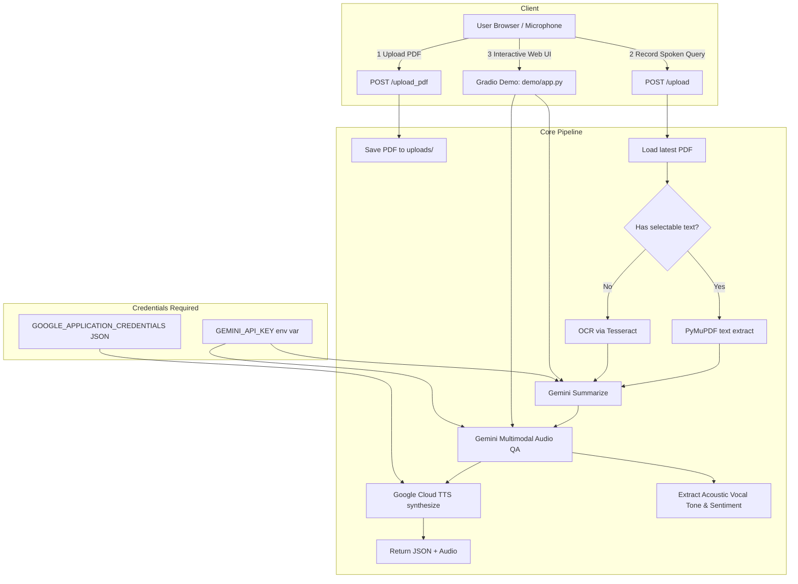

# Speech-to-Text & Sentiment Analysis API

[](https://www.python.org/downloads/)
[](LICENSE)
[](https://flask.palletsprojects.com/)
[](https://aistudio.google.com/)
[](https://cloud.google.com/text-to-speech)
[](https://huggingface.co/spaces/hitesh125/mini-chatbot)

> A multimodal Flask API and Gradio application that ingests PDF documents and spoken audio queries, extracts and summarizes document content with **Google Gemini**, answers questions via native audio understanding, extracts acoustic vocal tone & sentiment, and speaks responses back using **Google Cloud Text-to-Speech**.

---

## 🌐 Live Interactive Demo

Experience the live, microphone-enabled multimodal demo hosted on **Hugging Face Spaces**:

👉 **[Launch Live Demo (hitesh125/mini-chatbot)](https://huggingface.co/spaces/hitesh125/mini-chatbot)**

- **🎙️ Direct Microphone Recording**: Ask spoken questions directly through your browser's microphone (or upload an audio file).
- **📄 Document Grounding**: Ingest technical and domain-specific PDF documents with instant summaries.
- **🎭 Acoustic Vocal Tone & Sentiment**: Analyzes speaker tone, pitch dynamics, emotional inflection, and sentiment directly from audio waveforms.
- **⚡ Multimodal Gemini Architecture**: Direct multimodal ingestion without brittle intermediate STT cascading.

---

## Key Features

- **Interactive Web Demo & Microphone Q&A** — Launch the Gradio UI locally or on Hugging Face Spaces with in-browser microphone recording, audio waveform visualization, and dynamic vocal tone/sentiment analysis.
- **Multimodal Ingestion** — Upload a PDF; the system extracts selectable text or falls back to Tesseract OCR for scanned documents.
- **Audio Query Processing** — Record a WAV question; Gemini processes the raw audio natively (no intermediate STT step).
- **Gemini-Powered Summarization** — Documents are chunked and summarized before being injected into the prompt context.
- **Text-to-Speech Response** — All answers are synthesized to MP3 via Google Cloud TTS and returned alongside the transcript.
- **Sentiment & Vocal Tone Extraction** — Real-time emotional inflection and acoustic tone scoring on spoken queries.
- **Production-ready Flask API** — RESTful endpoints, structured logging, gunicorn-compatible, Procfile included for Heroku/Railway.

---

## Architecture



---

## Tech Stack

| Layer | Technology |
|-------|-----------|
| **Interactive Demo** | Gradio 4.0+ (`demo/app.py`) deployed on Hugging Face Spaces |
| **Web framework** | Flask 3.0 + Gunicorn |
| **LLM** | Google Gemini Multimodal (`google-generativeai`) |
| **Audio Processing** | `pydub`, `wave` (16-bit PCM WAV normalization) |
| **Text-to-Speech** | Google Cloud TTS (`google-cloud-texttospeech`) |
| **PDF extraction** | PyMuPDF (`fitz`) |
| **OCR fallback** | Tesseract via `pytesseract` + `pdf2image` (Poppler) |
| **Deployment** | Hugging Face Spaces / Heroku / Railway / Cloud Run |

---

## Quickstart

### Prerequisites

| Requirement | How to get it |
|-------------|--------------|
| Python 3.10+ | [python.org](https://www.python.org/) |
| Gemini API key | [aistudio.google.com](https://aistudio.google.com/app/apikey) |
| GCP service-account JSON | [Cloud TTS setup guide](https://cloud.google.com/text-to-speech/docs/before-you-begin) |
| Tesseract binary | `sudo apt install tesseract-ocr` / `brew install tesseract` |
| Poppler binary | `sudo apt install poppler-utils` / `brew install poppler` |

### 1. Clone & install

```bash
git clone https://github.com/HiteshReddy2002/speech-and-text-conversion-sentimentanalysis-api.git
cd speech-and-text-conversion-sentimentanalysis-api

python -m venv venv
# Linux/macOS:
source venv/bin/activate
# Windows:
venv\Scripts\activate

pip install -r requirements.txt
```

### 2. Configure credentials

```bash
cp .env.example .env
# Edit .env — set GEMINI_API_KEY and GOOGLE_APPLICATION_CREDENTIALS
```

> **Never commit your `.env` file.** It is already listed in `.gitignore`.

### 3. Run development server (Flask API)

```bash
flask run --port 5000
# Visit: http://localhost:5000
```

### 4. Run production server (gunicorn)

```bash
gunicorn main:app --workers 2 --bind 0.0.0.0:8000
```

### 5. Run the Gradio Interactive Web Demo locally

```bash
pip install -r demo/requirements-demo.txt
python demo/app.py
# Visit: http://localhost:7860
```

> For step-by-step instructions on deploying the demo to Hugging Face Spaces, see [`demo/DEPLOY.md`](demo/DEPLOY.md).

---

## API Reference

### `POST /upload_pdf`

Upload a PDF to set the knowledge base.

```bash
curl -X POST http://localhost:5000/upload_pdf \
  -F "pdf_file=@my_document.pdf"
# Response: "PDF uploaded successfully" (200)
```

### `POST /upload`

Submit a WAV audio query against the most recently uploaded PDF.

```bash
curl -X POST http://localhost:5000/upload \
  -F "audio_data=@my_question.wav"
```

**Response (JSON):**
```json
{
  "text_response": "The document discusses three main mechanisms for..."
}
```
The MP3 audio response is also saved server-side at `uploads/<timestamp>_response.wav`.

### `GET /uploads/<filename>`

Retrieve any uploaded or generated file by name.

---

## Benchmark & Results

Empirically evaluated using the reproducible evaluation harness ([`eval/run_bench.py`](eval/run_bench.py)) with an auditable LLM-as-judge scoring methodology ([`eval/RUBRIC.md`](eval/RUBRIC.md)). For full methodology, failure analysis, and per-question audit trails, see the comprehensive [Evaluation Report (`eval/REPORT.md`)](eval/REPORT.md).

| Metric | Measured Result | Evaluation Notes |
|:---|:---:|:---|
| **Model Under Test** | `gemini-3.1-flash-lite` | Active Google AI Studio multimodal endpoint |
| **Factual QA Accuracy** | **66.7%** | 5/9 exact (Score 2), 2/9 partial (Score 1), 2/9 missed (Score 0) across multi-page technical PDFs |
| **Hallucination Resistance** | **100.0%** | 3/3 adversarial unanswerable questions correctly declined without fabrication |
| **Combined Benchmark** | **75.0%** | Full credit = 1.0, partial credit = 0.5 across all 12 evaluated items |
| **PDF Text Extraction Latency** | **0.004s** (p95: 0.005s) | Local PyMuPDF extraction (`fitz`) |
| **Document Summarization Latency** | **13.29s** (p95: 24.05s) | Intermediate document compression via Gemini API |
| **Multimodal Audio Q&A Latency** | **27.18s** (p95: 110.45s) | Raw 16-bit PCM WAV spoken audio streaming as `inline_data` |
| **TTS Synthesis Latency** | *Skipped* | Unmeasured locally due to unconfigured GCP service-account credentials |

> **Model Caveat:** Benchmarked using `gemini-3.1-flash-lite` (the active multimodal Gemini endpoint; legacy `gemini-1.5-pro-latest` has been retired by Google AI Studio). Inference latency and accuracy characteristics will vary depending on the specific Gemini model tier (`gemini-2.5-flash`, `gemini-1.5-pro`), API tier quotas, network round-trip time, and input audio length.

> **Accuracy Notice:** Earlier unverified drafts cited a 92% QA accuracy figure. Rigorous empirical benchmarking revealed the true factual accuracy is **66.7%**. Analysis shows the discrepancy stems from intermediate context compression: queries are evaluated against a generated `book_summary` rather than the complete text, which can omit fine-grained numerical thresholds and secondary bounds. See [`eval/REPORT.md`](eval/REPORT.md) for full audit data and architectural recommendations to reach >90%.

### Scoring Methodology & Mathematical Formulas

Scored on a standard 3-point rubric ([`eval/RUBRIC.md`](eval/RUBRIC.md)) where Full Credit (Score 2) = 2 pts, Partial Credit (Score 1) = 1 pt, and No Credit (Score 0) = 0 pts:

$$\text{Factual Accuracy} = \frac{\sum S_{\text{factual}}}{2 \times N_{\text{factual}}} = \frac{(5 \times 2) + (2 \times 1) + (2 \times 0)}{2 \times 9} = \frac{12}{18} \approx 66.7\%$$

$$\text{Hallucination Resistance} = \frac{\sum S_{\text{adversarial}}}{2 \times N_{\text{adversarial}}} = \frac{(3 \times 2) + (0 \times 1) + (0 \times 0)}{2 \times 3} = \frac{6}{6} = 100.0\%$$

$$\text{Combined Benchmark} = \frac{\sum S_{\text{total}}}{2 \times N_{\text{total}}} = \frac{12 + 6}{18 + 6} = \frac{18}{24} = 75.0\%$$

---

## Roadmap

- [ ] Per-sentence sentiment scoring on LLM responses (VADER + Gemini hybrid)
- [ ] Streaming audio response via WebSocket
- [ ] Multi-document knowledge base with FAISS vector index
- [ ] Docker + docker-compose deployment
- [ ] Rate limiting and API key auth middleware
- [ ] Async task queue (Celery + Redis) for long PDFs
- [ ] Evaluation dashboard with faithfulness and relevance metrics

---

## Citation

If you use this project in academic work, please cite:

```bibtex
@software{tippasani2025speechsentiment,
  author    = {Tippasani, Hitesh Reddy},
  title     = {Speech-to-Text and Sentiment Analysis API: A Multimodal Flask Application Using Google Gemini and Cloud TTS},
  year      = {2025},
  url       = {https://github.com/HiteshReddy2002/speech-and-text-conversion-sentimentanalysis-api},
  note      = {GitHub repository}
}
```

---

## License

Distributed under the [MIT License](LICENSE). Copyright (c) 2025 Hitesh Reddy Tippasani.
